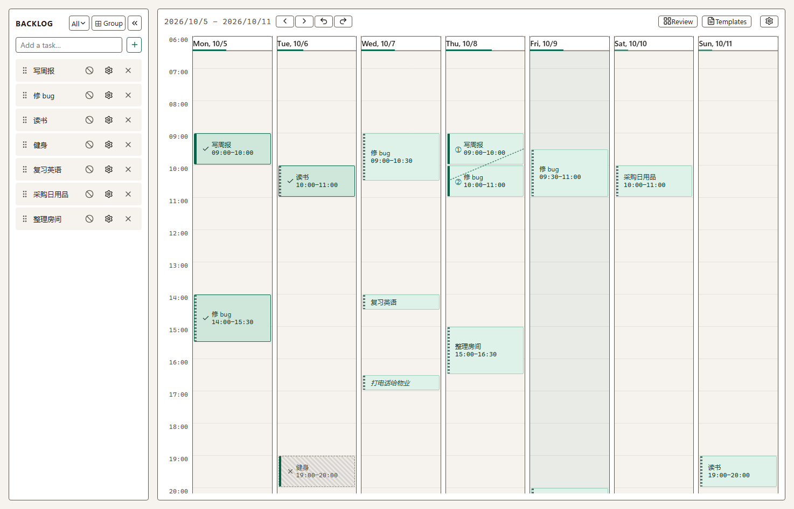
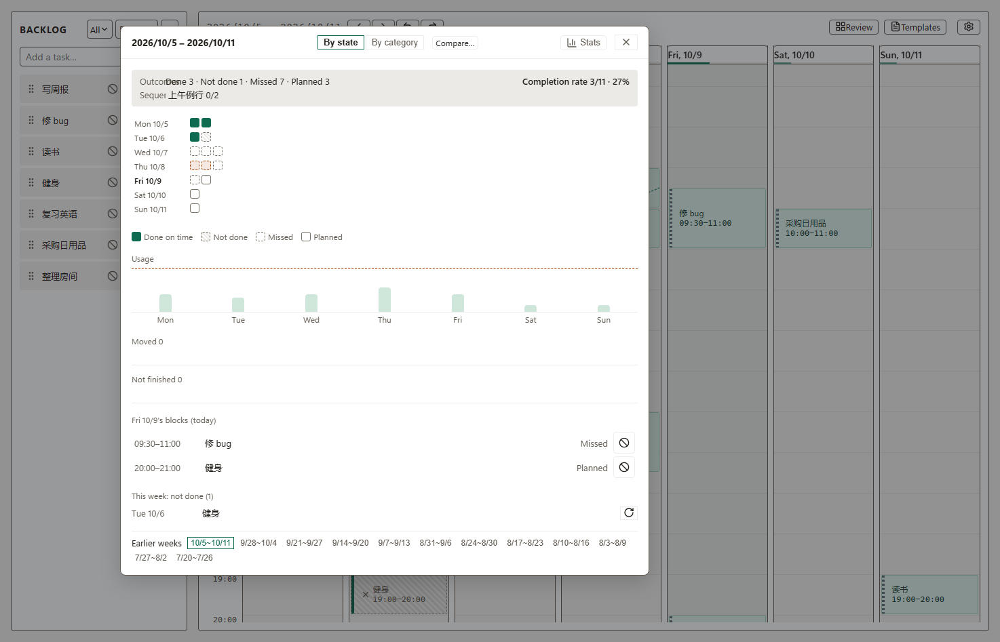
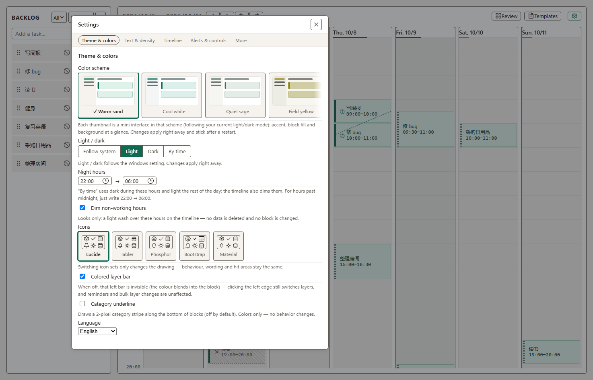

# WakeyWeeky

**Lay out your week.**

A local-first weekly planner for Windows — drag your to-dos onto this week's timeline and get reminded when it's time to mark how it went. Everything lives on your own machine: no network, no account, no telemetry.

[Download the latest release](https://github.com/Josephchue/wakeyweeky/releases) · [Quick start](#quick-start) · [User guide (中文)](docs/使用说明.md) · [中文](README.md) / **English**



## What it is

The left side is a **task backlog**; the right side is **this week as 7 days × 48 slots**. Drag a task across and your week is planned.

When a block starts or ends it pings you with a system notification — and you can answer the reminder right there with "done" or "missed". Tasks you never got around to don't just vanish: a **drift card** asks you whether you still want to place them. At the end of the week (or whenever you hit **Overview**) you can see what got done and where the time actually went.

It exists because planning usually stops at making a list — and a list never reminds you, and never tells you where your hours went. Here the list becomes "drag it to a time, get reminded, leave a result behind".



## Features

- **Drag to schedule** — drop a task on any slot; drag its edge to change duration; double-click an empty slot for an ad-hoc block
- **Timely reminders** — separate start/end reminders; the end one can be answered with "done / missed"; do-not-disturb (30 min / 2 h / until tomorrow morning)
- **Background fallback (off by default)** — only if you turn it on does it register a Windows Task Scheduler entry so reminders fire while the app is closed
- **Timeline** — cross-week blocks, automatic merging of adjacent same-task blocks, remnant marks at the old position, drift cards for unscheduled work
- **Sequences** — chain blocks that must happen in order; they follow along and shift when interrupted
- **Review & stats** — overview of done / missed / unused / planned, per-category time invested, a two-week mosaic comparison, and a stats panel
- **Templates & weekly repeats** — save a week as a skeleton and stamp it onto another week; or give a task a rule like "Wed 19:00"
- **Clipboard gestures** — `Ctrl+X` to move, `Ctrl+C` to copy; the preview follows your mouse and the left click drops it (one-step undo)
- **Multi-select & bulk edit** — `Ctrl+click`, `Shift+click`, or drag a marquee; move / copy / complete / delete a whole group
- **Achievements** — 98 hidden-style achievements (on by default, can be turned off)
- **Appearance** — 12 palettes (9 of them with decoration and a display typeface), light/dark, density and font size, five UI font families, 12/24-hour clock, date formats, hide weekends, time scale
- **Bilingual UI** — 中文 / English
- **All data is local** — one SQLite file; export/restore backups, export an `.ics` calendar, or use portable mode (copy the whole folder to a USB stick)



## Quick start

1. **Install** — grab `WakeyWeeky_<version>_x64_en-US.msi` from [Releases](https://github.com/Josephchue/wakeyweeky/releases) and double-click it (Windows 10/11, 64-bit). Windows may warn about an unknown publisher the first time — see [below](#why-unknown-publisher).
2. **Add a task** — type a name in "添加任务…" on the left and press Enter.
3. **Place it** — drag it onto the timeline (say, Wednesday afternoon).
4. **Answer the reminder** — when it pops up, click done or missed. That's the whole difference from a plain to-do list.
5. **Look back** — `▦ Overview` for the week's results, `▤ Stats` for trends. (The UI ships in Chinese and English; switch in Settings.)

Press `?` at any time for the full **keyboard map** — every binding can be changed in Settings → More.

## Download & install

| | |
| --- | --- |
| **Installer** | the `.msi` in [Releases](https://github.com/Josephchue/wakeyweeky/releases) (64-bit, needs admin rights) |
| **Portable** | `WakeyWeeky-<version>-portable.zip` from the same page — unzip and run; data goes to a `data\` folder next to the exe, so the whole folder travels on a USB stick |
| **Requirements** | Windows 10 / 11 (64-bit). Windows 11 ships WebView2; on Windows 10 you may need the [WebView2 Runtime](https://developer.microsoft.com/microsoft-edge/webview2/) |
| **Build from source** | see [CONTRIBUTING.md](CONTRIBUTING.md) |

Uninstalling does **not** delete your data (it lives under `%APPDATA%`, see below).

### Why "unknown publisher"

The installer is not code-signed (a certificate costs money for a personal project). SmartScreen will therefore ask once — click **More info** → **Run anyway**. The source is right here, and you can also build the installer yourself.

## Where your data lives

```text
%APPDATA%\com.wakeyweeky.app\wakeyweeky.sqlite      ← tasks, schedule, sequences, templates, settings
```

(In portable mode: `data\wakeyweeky.sqlite` next to the app.)

- **Backup** — Settings → Data → "Export backup"; restore from that file later (it covers the current data and restarts the app, keeping a "before restore" copy first).
- **Calendar export** — Settings → Data → "Export `.ics`" to pull your schedule into your phone's calendar (times are UTC, so the instant is preserved).
- **Move the data** — portable mode keeps the database with the app folder, and the data-location panel shows both copies side by side so you can pick which one wins (the losing side is renamed, never deleted).

## Privacy

- **No network.** There is no HTTP call anywhere in the app — no telemetry, no update check, no account. Watch it in your firewall if you like.
- **Nothing written elsewhere.** It only reads and writes the database file above; tray and notifications are plain OS features.
- **No sneaky background work.** Nothing is registered by default; only if you explicitly enable "wake up while the app is closed" does it register a Task Scheduler entry — and turning it off removes it.

## FAQ

**Sync / mobile app?** No, on purpose: the data belongs to this machine. Move it by hand with backup export / `.ics`.

**Will I lose my data?** It's a plain SQLite file any tool can open. The app runs an integrity check at startup, and you can export a backup whenever you like.

**Why no accounts / cloud / subscriptions?** Because this is a small tool made for personal use: the fewer dependencies, the more likely it still runs in ten years.

**Can I change the shortcuts?** Yes — press `?` for the map, then Settings → More → Keymap (e.g. rebind "open stats" from `S`).

**Dark mode?** Yes, plus an optional "night dimming" window.

## Development

```bash
npm install
npm run tauri dev          # dev mode (first run compiles Rust deps, a few minutes)
npm run tauri build        # build the MSI (output in src-tauri/target/release/bundle/msi/)
```

Stack: Tauri 2 (Rust) + Svelte 5 + TypeScript + SQLite (`rusqlite`, bundled) + Vite.

Coding style, tests and gates, pull-request rules, and how to verify the UI with fake data: **[CONTRIBUTING.md](CONTRIBUTING.md)**.
Architecture and design trade-offs: [`docs/设计笔记.md`](docs/设计笔记.md) (Chinese).

## License & credits

- Code: [MIT](LICENSE).
- **Fonts**: the bundled display faces Poiret One / Jost / Archivo Black / Marcellus and Samigirian (block titles) are all under the **SIL Open Font License 1.1**; the license texts ship with the installer (`resources/`).
- **Icons**: lucide (ISC), tabler (MIT), phosphor (MIT), bootstrap (MIT), Material Symbols (Apache-2.0) — full texts and the per-icon mapping in [`src-tauri/resources/ICONS-LICENSE.md`](src-tauri/resources/ICONS-LICENSE.md).
- **Dependencies**: Tauri / Svelte / date-fns and friends — see [THIRD-PARTY.md](THIRD-PARTY.md).

---

<sub>About: a weekly planner one person wrote for themselves. If you were also looking for a way to *lay out your week* — welcome. Motto still pending: **Not as good as Notion Calendar!**</sub>
