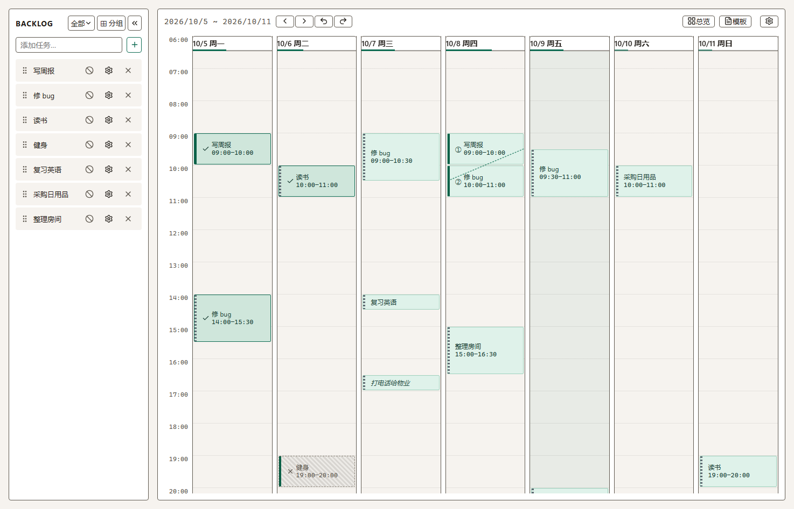
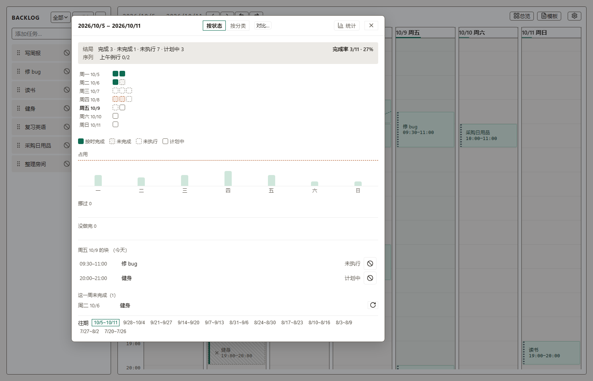
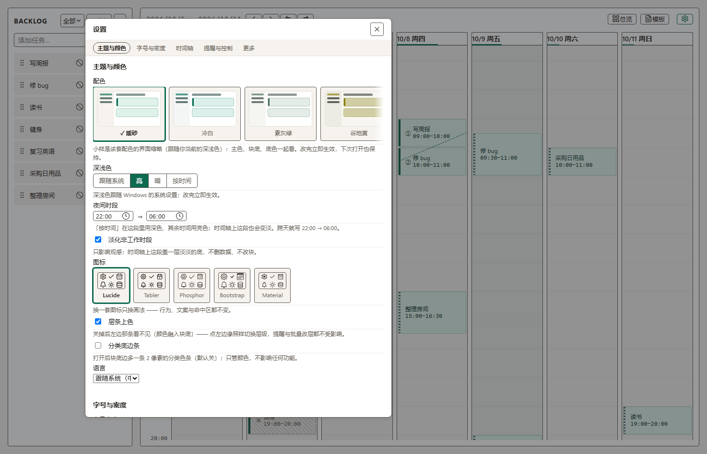

# WakeyWeeky

**把这一周摆出来。**

本地优先的 Windows 周计划工具 —— 把待办拖到本周时间轴上，到点提醒你标记结果。数据全部存在你自己的电脑上：不联网、不要账号、不收集任何信息。

[下载最新版](https://github.com/Josephchue/wakeyweeky/releases) · [快速上手](#快速上手) · [使用说明](docs/使用说明.md) · **中文** / [English](README.en.md)



## 这是什么

左边是**任务池**（Backlog），右边是**本周 7 天 × 48 格的时间轴**。从左边把任务拖到右边，这一周就排好了。

到点它会用系统通知提醒你；被提醒的那一块，你可以直接答「完成」或「未完成」。没排上的任务不会被忘掉 —— 它们会在**漂流卡**里主动来问你「还要不要安排」。一周结束（或随时点**总览**）能看到这周完成了什么、投入到了哪里。

它解决的是这么一件事：**计划常常停在「列清单」，而清单不会提醒你、也不会告诉你时间到底花在哪。** 这里把它变成「拖到具体时刻 → 到点被提醒 → 留下结果」。



## 功能一览

- **拖拽排程**：任务拖到时间轴任意格；拖边缘改时长；双击空白格放一个「临时安排」
- **到点提醒**：开始 / 结束两条；结束那条可以直接答「完成 / 未完成」；支持免打扰（30 分钟 / 2 小时 / 到明早）
- **后台兜底（默认关）**：打开后才会在 Windows 任务计划程序注册一条任务，应用关着也能按时唤醒提醒
- **时间轴**：跨周块、相邻同任务自动融合、残影（原位置会留一道浅色记号）、漂流卡（没排上的主动来问）
- **序列**：一串有先后的块连成一条线，跟着走、自动顺延；被打断会有提示
- **复盘与统计**：总览看完成 / 未完成 / 未执行 / 计划中、类别投入对比、两周马赛克对比；统计面板看趋势
- **模板与每周重复**：把某一周存成骨架下次一键铺开；也可以给任务加「周三 19:00」这样的重复规则
- **剪贴板手势**：`Ctrl+X` 搬、`Ctrl+C` 复制 —— 预览跟着鼠标走，左键落地（一步撤销）
- **多选与批量**：`Ctrl+左键`、`Shift+左键`、空白处框选；整组搬移 / 复制 / 完成 / 删除
- **成就**：98 条暗章式成就（默认开，可关）
- **外观**：12 套配色（其中 9 套带装饰与展示字）、深浅色、密度与字号、界面字体族五档、12/24 小时制、日期格式、隐藏周末、时间刻度
- **双语**：中文 / English
- **数据全在本地**：一个 SQLite 文件；导出备份 / 恢复 / 导出日历 `.ics` / 便携模式（整个文件夹拷走）



## 快速上手

1. **装**：从 [Releases](https://github.com/Josephchue/wakeyweeky/releases) 下载 `WakeyWeeky_<版本>_x64_en-US.msi` 双击安装（需要 Windows 10/11；第一次运行 Windows 可能提示「未知发布者」—— 点「更多信息 → 仍要运行」即可，见下面[为什么会有这个提示](#为什么提示未知发布者)）。
2. **加任务**：左边「添加任务…」敲一个任务名，回车。
3. **排进去**：把它拖到右边（比如周三下午那一格）。
4. **到点处理**：提醒弹出来时点「完成」或「未完成」——这就是它跟普通待办清单的区别。
5. **回头看**：点顶栏 `▦ 总览` 看这周的结果；点 `▤ 统计` 看趋势。

不熟的时候随时按 `?` —— 会弹出**键位总表**（所有键位都能在「设置 → 更多」里改）。

## 下载与安装

| | |
| --- | --- |
| **安装版** | [Releases](https://github.com/Josephchue/wakeyweeky/releases) 里的 `.msi`（64 位；需要管理员权限） |
| **便携版** | 同页的 `WakeyWeeky-<版本>-portable.zip`：解压即用，数据写在同目录 `data\`，整个文件夹拷到 U 盘就能带走 |
| **系统要求** | Windows 10 / 11（64 位）。Windows 11 自带 WebView2；Windows 10 若没有，装一次 [WebView2 运行时](https://developer.microsoft.com/microsoft-edge/webview2/) 即可 |
| **开发环境** | 见 [CONTRIBUTING.md](CONTRIBUTING.md) |

卸载**不会**删除你的数据（数据文件在 `%APPDATA%` 下，见下一节）。

### 为什么提示「未知发布者」

安装包没有做代码签名（个人开源项目，签名证书要花钱）。Windows SmartScreen 因此会拦一下：点「**更多信息**」→「**仍要运行**」即可。源码在仓库里，安装包也可以自己从源码构建。

## 你的数据在哪

```text
%APPDATA%\com.wakeyweeky.app\wakeyweeky.sqlite      ← 任务 / 排程 / 序列 / 模板 / 设置都在这个文件里
```

（便携模式下则是应用目录下的 `data\wakeyweeky.sqlite`。）

- **备份**：设置 → 数据 → 「导出备份」，存到外盘或网盘随你；「从备份恢复」会用备份覆盖当前数据并自动重启，重启前会自动留一份「恢复前副本」。
- **导出日历**：设置 → 数据 → 「导出 `.ics`」，把排程导进手机 / 系统日历（时间是 UTC，导入后显示的是同一时刻）。
- **想换个位置**：便携模式打开后，数据跟着应用文件夹走；可以在「数据位置」那里把两份数据并排摆出来，选哪份用哪份（被覆盖的一侧会先留副本，**只复制、从不删**）。

## 隐私

- **不联网**：应用里没有任何网络请求（没有遥测、没有更新检查、没有账号）；你可以在防火墙里观察它的连接数来验证。
- **不写别处**：只读写上面那个数据文件；托盘图标、通知都是系统本地能力。
- **不偷偷后台跑**：默认**不**注册任何计划任务；只有你在设置里显式打开「关闭应用后仍按时唤醒」才会注册，关掉即注销。

## 常见问题

**Q：会和手机 / 云同步吗？**
不会，这是刻意的设计取舍：数据只属于你这台机器。想要跨设备就用「导出备份 / 导出 `.ics`」自己搬。

**Q：会不会哪天打不开了 / 数据会不会丢？**
数据是一个标准 SQLite 文件，任何 SQLite 工具都能打开。应用每次启动会做一次完整性检查；建议定期「导出备份」到别处。

**Q：为什么不做账号 / 会员 / 云？**
这是个个人用的小工具：越少依赖，十年后越可能还能跑。

**Q：能改快捷键吗？**
能。`?` 打开键位总表；设置 → 更多 → 键位里可以重绑（例如把「打开统计」从 `S` 改成别的）。

**Q：界面有英文吗？**
有，中文 / English 两套，设置里切换（默认跟随系统）。

**Q：有深色模式吗？**
有，还可以设「夜间时段」自动淡化。

## 开发

```bash
npm install
npm run tauri dev          # 开发模式（第一次要编译 Rust 依赖，几分钟）
npm run tauri build        # 构建 MSI（产物在 src-tauri/target/release/bundle/msi/）
```

技术栈：Tauri 2（Rust）+ Svelte 5 + TypeScript + SQLite（`rusqlite`，内嵌）+ Vite。

代码风格、测试与闸门、PR 规矩、以及「怎么用假数据截图验证界面」：**[CONTRIBUTING.md](CONTRIBUTING.md)**。
架构与其它取舍：[`docs/设计笔记.md`](docs/设计笔记.md)。

## 许可与致谢

- 本项目代码：[MIT](LICENSE)（可自由使用、修改、分发，保留版权声明即可）。
- **字体**：自带展示字 Poiret One / Jost / Archivo Black / Marcellus 以及块标题用的 Samigirian —— 均为 **SIL Open Font License 1.1**，随安装包附带许可全文（`resources/`）。
- **图标**：lucide（ISC）、tabler（MIT）、phosphor（MIT）、bootstrap（MIT）、Material Symbols（Apache-2.0）—— 许可全文与逐条取用清单见 [`src-tauri/resources/ICONS-LICENSE.md`](src-tauri/resources/ICONS-LICENSE.md)。
- **依赖**：Tauri / Svelte / date-fns 等，清单与许可见 [THIRD-PARTY.md](THIRD-PARTY.md)。

---

<sub>关于：这是一个人写给自己用的周计划工具。如果你也在找「把这一周摆出来」的东西 —— 欢迎。口号先欠着：**不如 Notion Calendar！**</sub>
